<p align="center">
  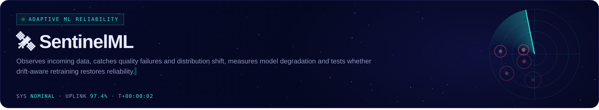
</p>

<h1 align="center">SentinelML</h1>
<p align="center"><b>Real-time adaptive machine learning & model reliability platform</b><br/>
Detects data-quality failures and distribution drift, measures model degradation, and tests whether
drift-aware retraining actually restores reliability — with every number traced to a logged experiment.</p>

<p align="center">
  <a href="https://github.com/YOUR-GITHUB-USERNAME/sentinelml/actions/workflows/ci.yml"></a>
  
  
  
  
  
  
  
</p>

<p align="center">
  <a href="#-highlights">Highlights</a> ·
  <a href="#-results">Results</a> ·
  <a href="#-screenshots">Screenshots</a> ·
  <a href="#-quick-start">Quick start</a> ·
  <a href="#-api">API</a> ·
  <a href="#-how-it-works">How it works</a> ·
  <a href="#%EF%B8%8F-limitations">Limitations</a>
</p>

---

## ✨ Highlights
- **Controlled experiment, not a demo:** static vs periodic vs drift-aware retraining on identical streams, **5 seeds × 4 drift types = 60 runs**, reported as mean ± 95 % CI.
- **Data-quality gate:** nulls, impossible values, unseen categories and duplicates are caught and cleaned *before* inference — and are not mistaken for drift.
- **Drift detection from scratch:** PSI + Bonferroni-corrected KS per feature, Page-Hinkley on the error stream, compact ADWIN — no black-box drift library.
- **Champion / candidate registry:** a retrained model is promoted only if it beats the champion on held-out recent data **and** meets a p95 latency budget.
- **Explainable:** permutation importance + per-prediction log-odds contributions (SHAP when installed).
- **Full product surface:** FastAPI service, 8-page animated "Mission Control" dashboard, SQLite store, Docker, CI, tests, executed notebooks.

## 🎯 Problem & research question
Models are trained on yesterday's data but serve today's. Missing values, shifting feature distributions and a changing
feature→label relationship silently erode accuracy, while a static model keeps predicting with unchanged confidence.

> **Can drift-aware retraining maintain predictive performance better than a static model or a fixed-interval
> retraining schedule when the data distribution changes?**

| | Hypothesis | Outcome |
|---|---|---|
| **H1** | Drift-aware retraining recovers faster than a static model | ✅ Supported under sudden, gradual and incremental drift (recurring: within CI) — recovery in ≈3 batches after sudden drift |
| **H2** | Drift-aware needs fewer retrains than a fixed schedule | 🟡 Partially — **1 vs 6** under sudden drift; no saving under gradual / recurring drift |
| **H3** | Quality checks stop preventable faults before inference | ✅ **0** false drift alarms despite injected quality faults |

## 📊 Results
*Synthetic controlled stream (12 000 records, drift at record 6 000), logistic-regression champion, mean ± 95 % CI over 5 seeds.*

| Drift type | Static | Periodic | **Drift-aware** | Retrains (periodic → drift-aware) |
|---|---|---|---|---|
| Sudden | 0.709 ± 0.012 | 0.901 ± 0.005 | **0.945 ± 0.003** | 6 → **1** |
| Gradual | 0.727 ± 0.013 | 0.904 ± 0.004 | **0.933 ± 0.005** | 6 → 6 |
| Incremental | 0.737 ± 0.011 | 0.913 ± 0.005 | **0.942 ± 0.005** | 6 → 4.4 |
| Recurring | 0.815 ± 0.005 | 0.743 ± 0.004 | **0.819 ± 0.008** | 6 → 6 |

<p align="center">
  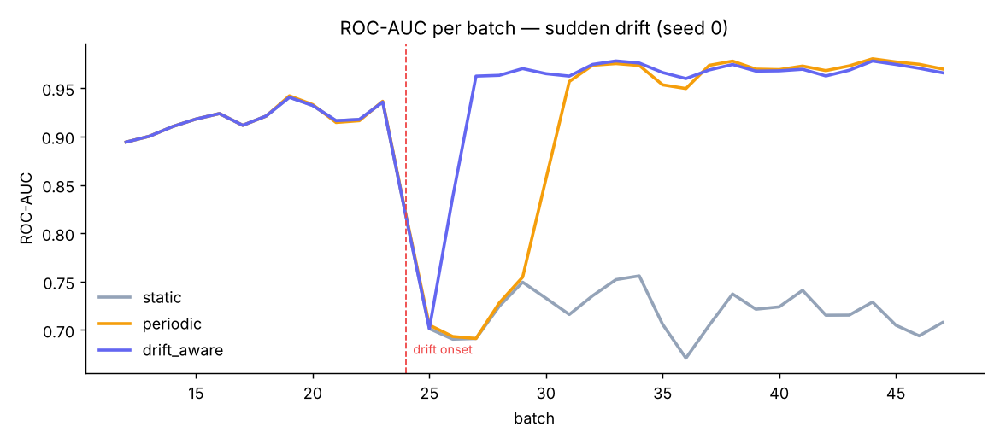
  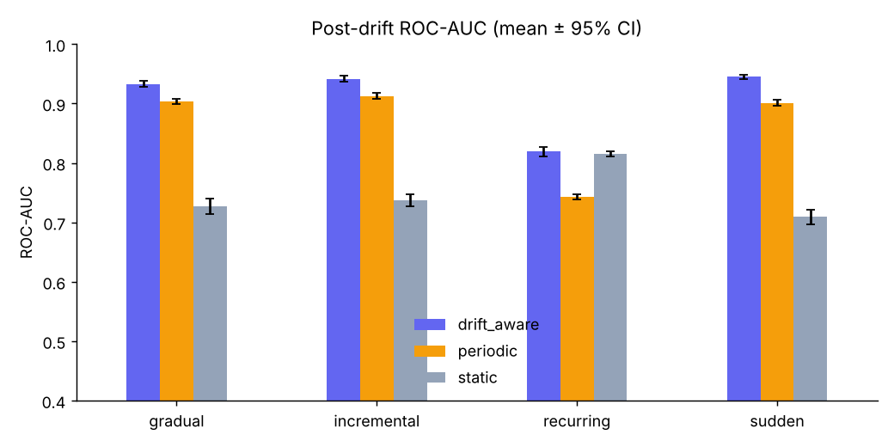
</p>

> **Honest reading.** Under *recurring* drift the old concept returns, so a static model is competitive and periodic
> retraining *hurts* — it keeps fitting a concept that is about to disappear. Full table:
> [`reports/experiment_summary.md`](reports/experiment_summary.md).

## 📸 Screenshots
<table>
  <tr>
    <td width="50%">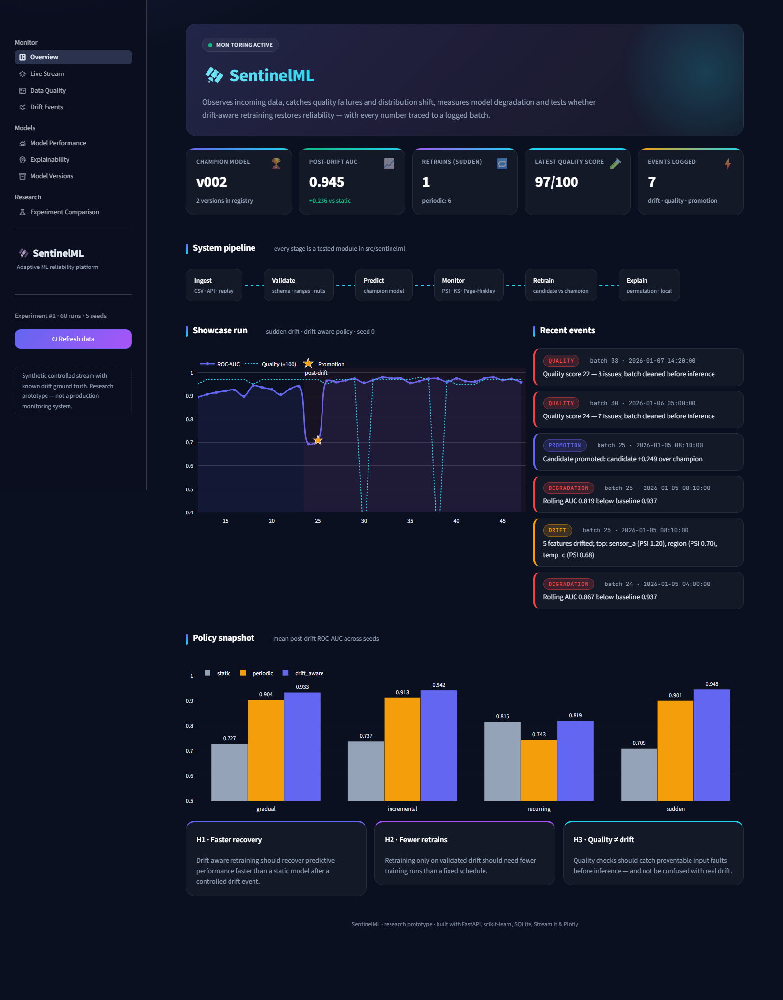<br/><sub><b>Overview</b> — radar hero, KPIs, pipeline, showcase run, events</sub></td>
    <td width="50%">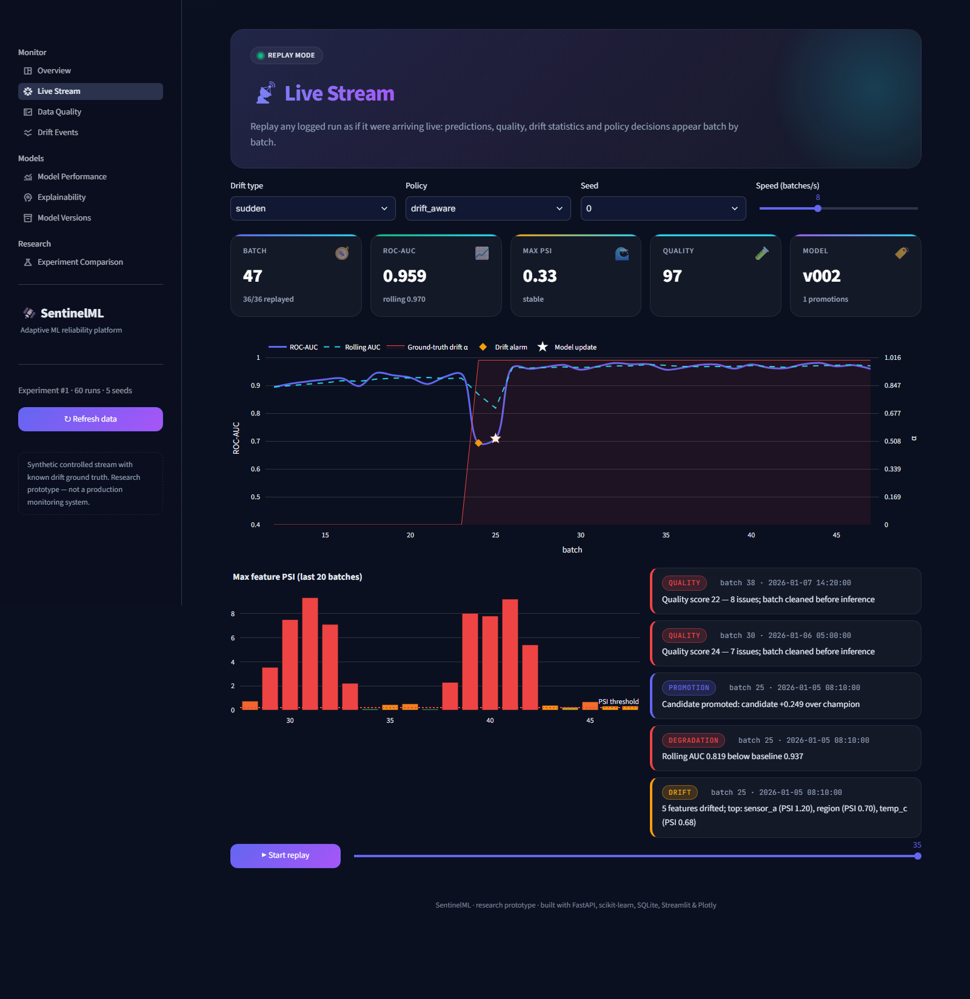<br/><sub><b>Live Stream</b> — animated batch-by-batch replay with drift alarms</sub></td>
  </tr>
  <tr>
    <td>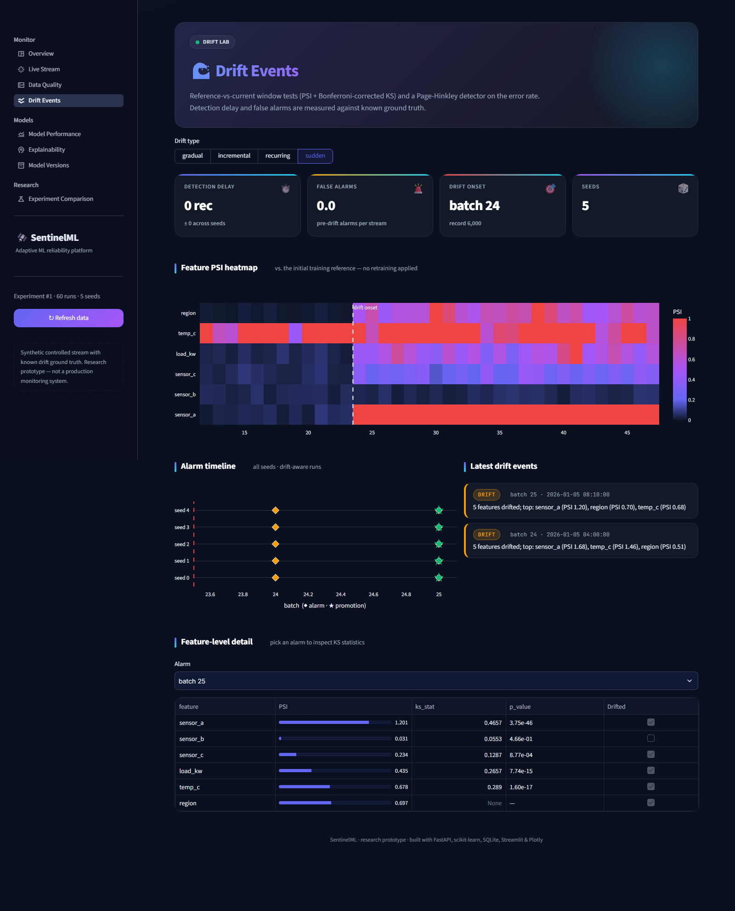<br/><sub><b>Drift Events</b> — feature × batch PSI heatmap and alarm timeline</sub></td>
    <td>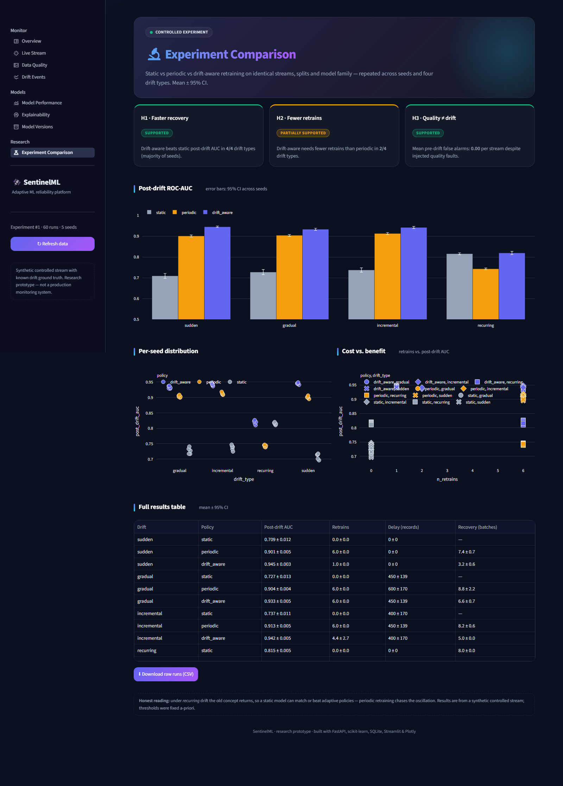<br/><sub><b>Experiment Comparison</b> — hypothesis verdicts computed from data</sub></td>
  </tr>
  <tr>
    <td>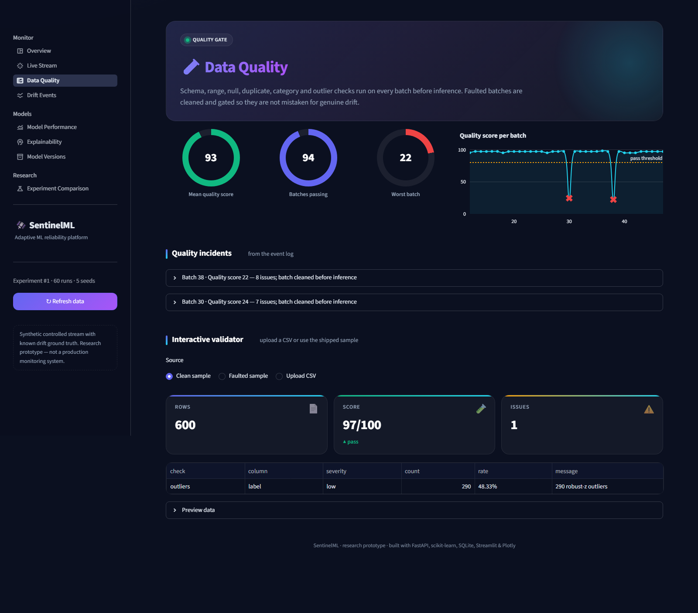<br/><sub><b>Data Quality</b> — quality rings, incidents, interactive CSV validator</sub></td>
    <td>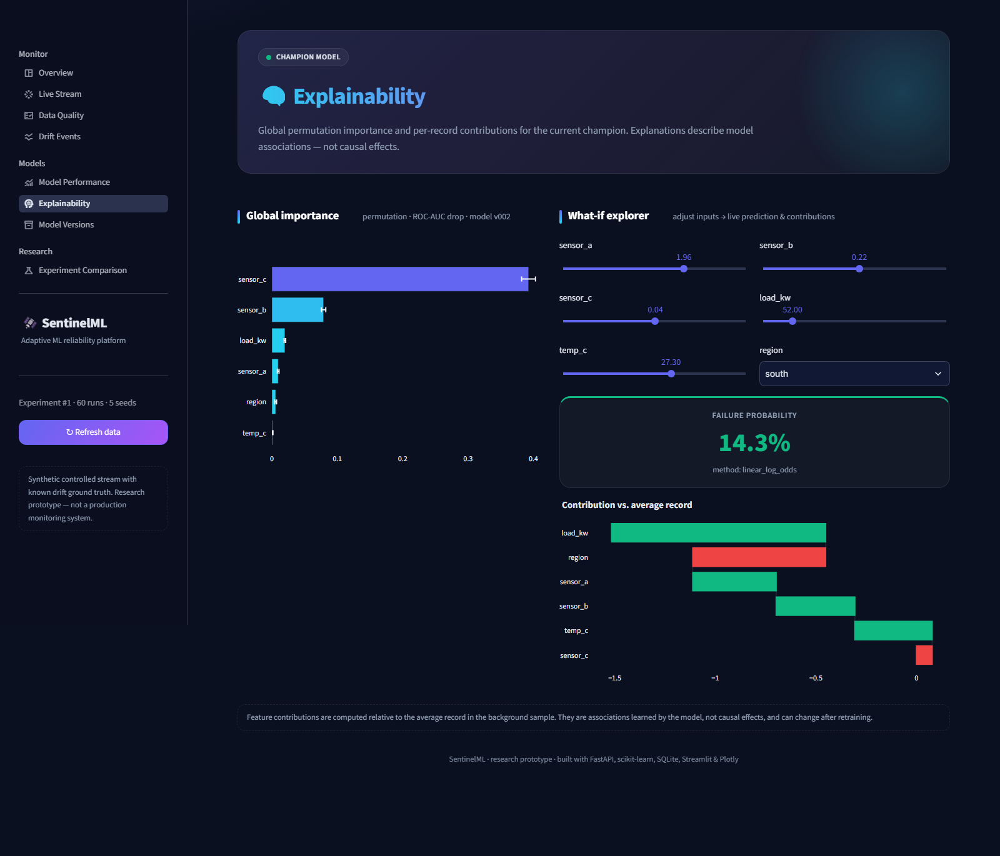<br/><sub><b>Explainability</b> — permutation importance + what-if waterfall</sub></td>
  </tr>
  <tr>
    <td>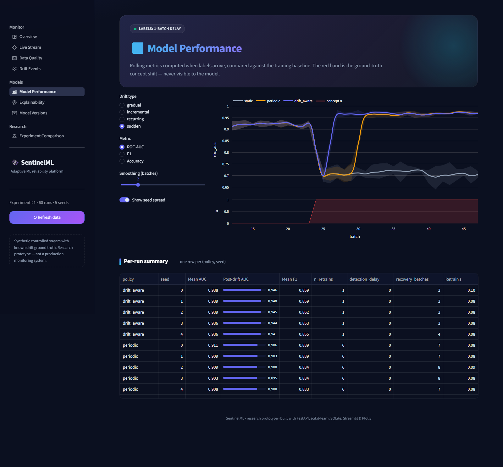<br/><sub><b>Model Performance</b> — rolling metrics with seed spread</sub></td>
    <td>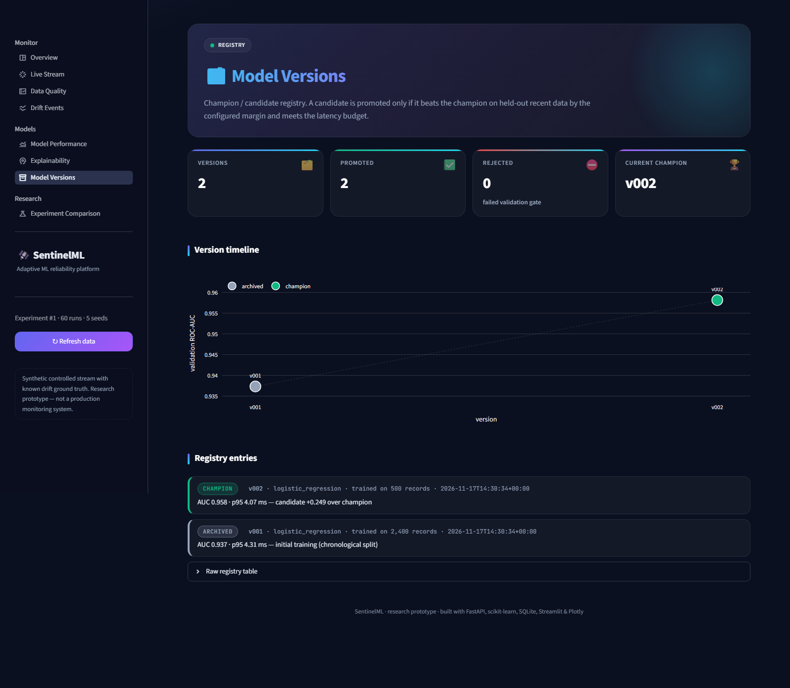<br/><sub><b>Model Versions</b> — champion / archived / rejected registry</sub></td>
  </tr>
</table>

## 🚀 Quick start
**Requirements:** Python 3.11 or 3.12 · ~1 GB disk · no GPU.

<details open>
<summary><b>Windows (PowerShell)</b></summary>

```powershell
git clone https://github.com/YOUR-GITHUB-USERNAME/sentinelml.git
cd sentinelml
py -3.12 -m venv .venv
.\.venv\Scripts\Activate.ps1          # if blocked: Set-ExecutionPolicy -Scope CurrentUser RemoteSigned
pip install -r requirements-dev.txt
pip install -e .
python -m sentinelml.cli pipeline      # ≈1.5 min (add --quick for ≈40 s)
streamlit run dashboard/app.py         # → http://localhost:8501
```
</details>

<details>
<summary><b>macOS / Linux</b></summary>

```bash
git clone https://github.com/YOUR-GITHUB-USERNAME/sentinelml.git && cd sentinelml
python3.12 -m venv .venv && source .venv/bin/activate
pip install -r requirements-dev.txt && pip install -e .
python -m sentinelml.cli pipeline
streamlit run dashboard/app.py
```
</details>

<details>
<summary><b>Docker</b></summary>

```bash
docker build -f docker/Dockerfile -t sentinelml .
docker run -p 8000:8000 -p 8501:8501 sentinelml
# API → http://localhost:8000/docs · Dashboard → http://localhost:8501
```
</details>

**API (second terminal):** `uvicorn api.main:app --reload --port 8000` → interactive docs at http://localhost:8000/docs

## 🔌 API
| Method | Endpoint | Purpose |
|---|---|---|
| `GET` | `/health` | Service health and current champion |
| `POST` | `/data/validate` | Validate a batch → quality score + issue list |
| `POST` | `/predict` | Probability, model version, latency and explanation |
| `GET` | `/monitoring/summary` | Latest quality, drift and model-health summary |
| `GET` | `/events` | Drift / quality / promotion events (filterable) |
| `GET` | `/models` | Registry: champion, archived and rejected versions |
| `POST` | `/experiments/run` | Start a controlled experiment (development only) |

```bash
curl -X POST localhost:8000/predict -H "Content-Type: application/json" \
  -d '{"record":{"sensor_a":1.2,"sensor_b":-0.3,"sensor_c":0.5,"load_kw":80,"temp_c":25,"region":"north"}}'
```
```json
{ "probability": 0.5449, "prediction": 1, "model_version": "v002", "latency_ms": 2.1,
  "top_factors": ["sensor_c (+1.288)", "region (−0.884)", "sensor_a (−0.689)"] }
```

## 🏗 How it works
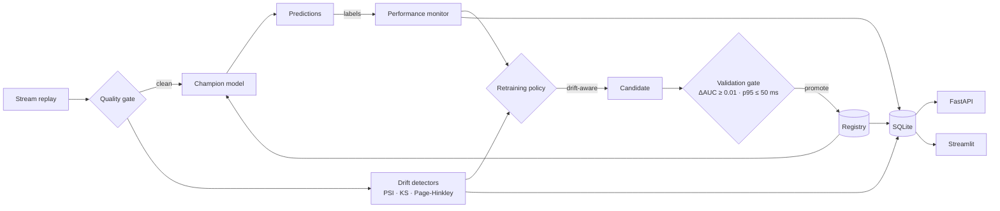

| Component | Method |
|---|---|
| Splits | Strictly chronological; first 3 000 records train the initial champion (80/20 internal) |
| Quality | Nulls, duplicates, dtype, range, unseen categories, robust-z outliers → 0–100 score, pass ≥ 80 |
| Drift | Per-feature PSI ≥ 0.2 **and** KS p < α/k; ≥ 2 features → event; Page-Hinkley on error rate |
| Policies | Static · periodic (every 6 batches, 2 000-record window) · drift-aware (alarm → candidate → gate) |
| Metrics | ROC-AUC, PR-AUC, F1, detection delay, false alarms, recovery batches, retrain count, p50/p95 latency |

More detail: [`docs/ARCHITECTURE.md`](docs/ARCHITECTURE.md) · Dataset: [`docs/DATA_CARD.md`](docs/DATA_CARD.md)

## 📁 Project structure
```
sentinelml/
├── configs/              data.yaml · model.yaml · monitoring.yaml
├── src/sentinelml/
│   ├── ingestion/        synthetic stream with drift ground truth · loaders · replay
│   ├── validation/       schema & data-quality engine
│   ├── features/         leakage-safe preprocessing
│   ├── models/           train · evaluate · latency
│   ├── monitoring/       PSI · KS · Page-Hinkley · ADWIN · rolling performance
│   ├── retraining/       policies · simulation loop · champion/candidate registry
│   ├── explainability/   permutation · SHAP / linear / substitution
│   ├── storage/          SQLite persistence
│   └── experiments/      multi-seed runner · CIs · report · figures
├── api/                  FastAPI service
├── dashboard/            Streamlit app — "Mission Control" design system + 8 views
├── notebooks/            01 exploration · 02 baselines · 03 drift experiments (executed)
├── tests/                28 tests: validation · features · drift · retraining · API
├── reports/              experiment_summary.md/.json · figures/
├── scripts/              capture_screenshots.py
├── docs/                 ARCHITECTURE · DATA_CARD · banner · screenshots
└── docker/Dockerfile · .github/workflows/ci.yml
```

## ✅ Testing & quality
```bash
pytest -q                     # 28 tests
ruff check .                  # lint
```
CI runs lint, tests on Python 3.11 / 3.12, the end-to-end pipeline, API tests and a Docker build on every push.

## ⚠️ Limitations
- Synthetic drift is cleaner than real drift — validate on NAB or UCI Electricity before drawing conclusions.
- Labels arrive one batch after prediction; real label delay is usually much longer.
- Thresholds were fixed a-priori; one model family in the main experiment.
- SQLite is a prototype store — use PostgreSQL for concurrent deployment.

## 🗺 Roadmap
- [ ] Real-data adapters for NAB and UCI Electricity
- [ ] MLflow tracking for every candidate
- [ ] Label-delay simulation and unsupervised performance estimation
- [ ] Azure Container Apps deployment

## 🔗 Related projects
| Project | Focus |
|---|---|
| 🛡️ [ThreatSense](https://github.com/YOUR-GITHUB-USERNAME/threatsense) | Explainable network anomaly detection |
| 🔬 [VisionGuard AI](https://github.com/YOUR-GITHUB-USERNAME/visionguard-ai) | Robust visual defect inspection |
| 🩺 [MedPredict Research](https://github.com/YOUR-GITHUB-USERNAME/medpredict-research) | Calibrated, fair clinical risk models |

## 👤 Author
**Padmashree Shah** · [GitHub](https://github.com/YOUR-GITHUB-USERNAME) · [LinkedIn](https://www.linkedin.com/in/YOUR-LINKEDIN)

<sub>MIT licensed · research prototype built for portfolio purposes · not affiliated with or endorsed by Microsoft.</sub>
