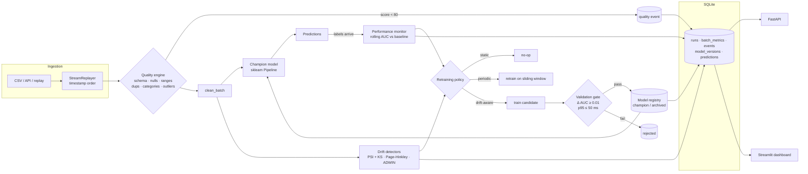

# SentinelML — Architecture

## Design decisions
| Decision | Rationale |
|---|---|
| PSI **and** KS must both fire per feature | KS alone over-fires on large batches; PSI alone ignores sample size. |
| ≥ 2 drifted features to raise an event | Reduces single-feature noise alarms (configurable). |
| Quality-faulted batches cannot trigger drift retraining | Separates preventable input problems from genuine drift (H3). |
| Candidate validated on the *latest* batch, held out from its training | Fair champion-vs-candidate comparison on unseen recent data. |
| Logistic regression default | Best validation AUC on this task (0.937 vs 0.915 RF / 0.910 HGB), ~8× faster than RF, exact additive explanations. |
| SQLite prototype | Zero-ops; the `Database` class isolates SQL so PostgreSQL is a DSN change. |
| No external drift library | Transparent, tested implementations; Evidently/River can be plugged in. |

## Module map
| Package | Responsibility |
|---|---|
| `ingestion/` | synthetic generator with ground truth, CSV loader, stream replayer |
| `validation/` | quality checks, scoring, batch cleaning |
| `features/` | leakage-safe `ColumnTransformer` |
| `models/` | training, metrics, latency profiling |
| `monitoring/` | PSI, KS, Page-Hinkley, ADWIN, rolling performance |
| `retraining/` | policies, simulation loop, champion/candidate registry |
| `explainability/` | permutation importance, SHAP / linear / substitution local explanations |
| `storage/` | SQLite persistence |
| `experiments/` | multi-seed runner, aggregation with 95 % CIs, report + figures |
